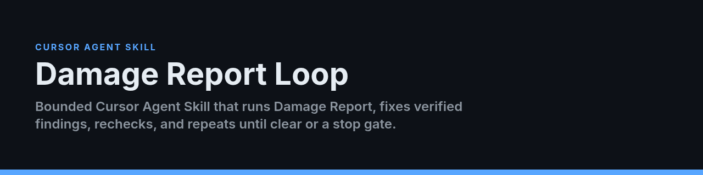

<p align="center">
  
</p>

# Damage Report Loop

**Bounded Cursor Agent Skill that runs Damage Report, fixes verified findings, rechecks, and repeats until clear or a stop gate.**

[](LICENSE)


A bounded Cursor Agent Skill that repeatedly:

1. runs a Damage Report,
2. fixes verified high-impact findings,
3. runs targeted and full checks,
4. audits the new diff,
5. and repeats until the branch is clear or a defined stop condition is reached.

It is inspired by the iterative review pattern of Greploop but does not require Greptile.

## Modes

### Local mode — default

```text
/damage-report-loop
```

Edits and tests the current worktree. It does not commit or push.

### Local commit mode

```text
/damage-report-loop --commit
```

Creates focused local commits after verified iterations.

### Pull request synchronization

```text
/damage-report-loop 123 --pr-sync --resolve
```

Commits, pushes normally to the existing PR branch, waits for current-head checks, refreshes review feedback, and continues. It never force-pushes or merges.

## Installation

Install the companion report skill first:

```bash
git clone https://github.com/Awkward8787/damage-report.git
cd damage-report
./scripts/install.sh --user
```

Then install this skill:

```bash
git clone https://github.com/Awkward8787/damage-report-loop.git
cd damage-report-loop
./scripts/install.sh --user
```

For one project:

```bash
./scripts/install.sh --project /absolute/path/to/your/project
```

Manual locations:

```text
~/.cursor/skills/damage-report-loop/
<project>/.cursor/skills/damage-report-loop/
```

`SKILL.md` must be at the skill root.

## Usage

```text
/damage-report-loop
/damage-report-loop --max 3
/damage-report-loop --quick --max 5
/damage-report-loop --base origin/develop
/damage-report-loop security and authentication
/damage-report-loop 123 --pr-sync
/damage-report-loop 123 --pr-sync --resolve --include-p3
```

## Exit conditions

The skill stops when:

- the final full Damage Report is clear,
- a safety or product decision blocks safe progress,
- required evidence or environment access is unavailable,
- or the bounded iteration limit is reached.

The default limit is five iterations; the absolute maximum is ten.

## State and reports

```text
.cursor/damage-reports/latest.md
.cursor/damage-reports/loop-state.json
```

These files are local workflow artifacts and are not staged automatically.

## Optional stop hook

An optional Cursor stop hook is included at:

```text
hooks/damage-report-loop.mjs
```

See `references/HOOK_SETUP.md`. The core skill works without the hook.

## Requirements

- Cursor Agent Skills
- `git`
- Project build/test toolchain
- Optional: authenticated `gh` for PR synchronization
- Recommended: companion `damage-report` skill

## Safety posture

The loop preserves unrelated user changes, refuses force-push, does not merge PRs, and pauses on auth, destructive migration, public contract, production infrastructure, or ambiguous product decisions.

## License

MIT
